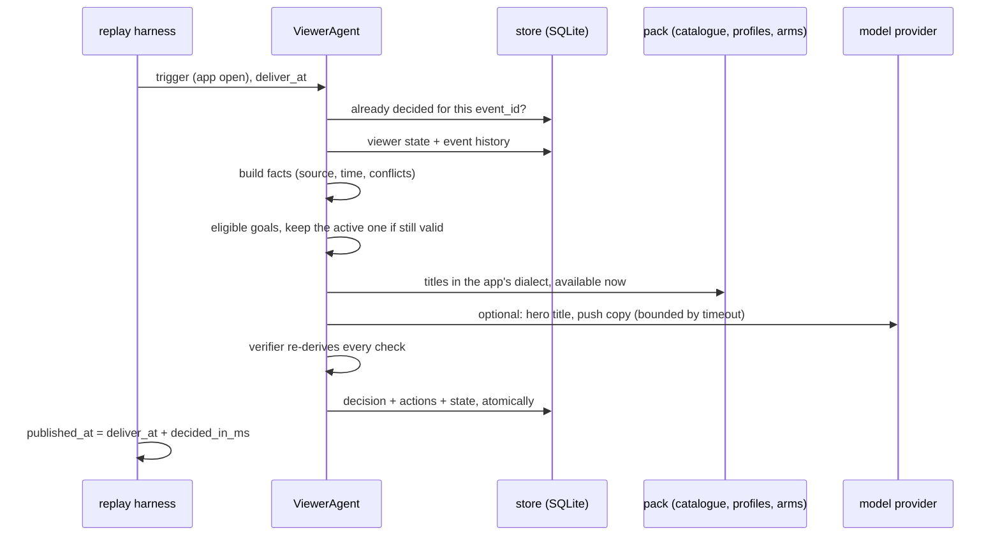
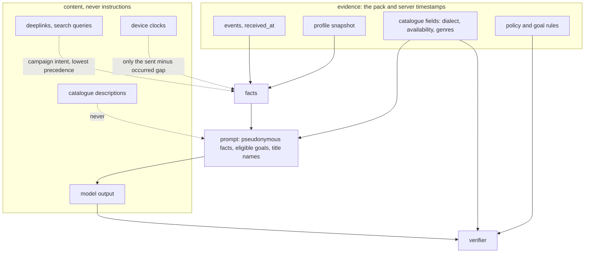

# Architecture

One agent per viewer, a deterministic core, and a model that may only advise. This note covers ownership,
planning, memory, verification, latency, failure recovery and trust boundaries, in that order, then measurement.

## One decision, end to end

## Ownership

`ViewerAgent` is created per `user_id` and owns that viewer's goal, single active plan and history. The agent
object is stateless; everything durable is a single state document in SQLite keyed by `user_id`, so two
components can never pursue different goals for one viewer. Holdout viewers have an agent too: it chooses the
goal (a "shadow" goal, so the arms stay comparable) and publishes nothing.

## Planning

The goal is chosen by rules in `goals.py`, never by the model, so treatment and holdout get identical goal
assignment. The active goal is kept while its window is open and the viewer still qualifies. It is revised on a
state change, not on a schedule: a purchase closes a monetisation goal the moment the event arrives
(`handle_event`), a lapse closes subscriber goals, an expired window closes the goal for judgement, and the next
open starts a fresh choice. Two goals are never offered: G10 has no success event and G11's event never occurs in
the stream, which the rule book detects at start-up.

Interventions are proportionate. A home page is the default because it needs no consent and the app shows it only
while the viewer is there. One message at most, only for goals with a concrete hook (resume a series, a new
release, a trial ending), sent the next evening, WhatsApp before push when both are allowed. "Do nothing" is a
recorded decision with a reason: holdout, buffered-offline trigger, duplicate, page still live, no catalogue in the
app's dialect, no evidence yet, no measurable goal, or a verifier veto with no smaller safe action.

## Source handling and freshness

Every fact carries `source`, `observed_at` and evidence refs (`event:<id>`, `profile:<user>@<updated_at>`,
`trigger:<id>`). Precedence is fixed per fact:

| Fact | Wins | Why |
|---|---|---|
| dialect | app setting on the trigger, then profile, deeplink last | the app only shows a page for the dialect it is set to; the campaign link is intent, not reality |
| subscription status | purchase / renewal / lapse event received after the snapshot's `updated_at` | events are primary, the warehouse export is a day stale |
| consent | snapshot flag, overridden by a later `notification_opt_out` | policy rule 1 |
| signup, plays, completions, visits | events | the snapshot has no row for new viewers |
| duplicate profile rows | newest `updated_at` | same rule the platform simulator applies |

Conflicts are never resolved silently; they are listed on the decision (`conflicts`, `dialect.conflicts`).
Trigger freshness uses the device's own `sent_at - occurred_at` gap, which is reliable even when its clock is not:
an open buffered for more than ten minutes is not a live visit, so facts are recorded and nothing is published.

## Memory

`store.py` holds four tables: the event history (the viewer data store, de-duplicated by `event_id`), one state
document per viewer, every decision (indexed by trigger `event_id` for idempotency) and every action. The state
document carries the fact snapshot, the active goal, goal history with outcomes, decision and action ids, and
plain-language learnings written by the agent and the judge. `viewer_state/<user_id>.json` exports all of it with
the decision and action records inlined; `inspect <user_id>` prints the same.

## Verification

`verifier.py` runs after the planner and can veto it. It does not trust the planner's facts: it re-reads the
viewer's events from the store and recomputes eligibility on that fresh read (an event that arrived after planning
can still stop the action), and it derives consent with its own code straight from the profile row and opt-out
events. The holdout arm, page dialect, availability at publish time (withdrawals included), page rules, the daily
cap from stored actions, templates and copy are checked against the pack and policy. "New episode" copy is allowed
only for a recent release. Each check has a scope: a failed message check drops the message and keeps the page; a
failed page check drops the page; holdout or eligibility failures drop everything. The rule code itself is shared
with the planner, so a wrong rule would pass both; the tests pin each rule instead.

Model output is generated text: a goal claim without an eligible rule behind it is rejected with the eligible set
cited, and copy that contains instruction-like phrases is discarded. The same pattern scans the catalogue at load,
so descriptions that try to instruct an AI are flagged in the run summary (they are never sent to the model).

## Latency and budget

Each decision runs under a `Budget`: at most 8 model calls and 20 tool calls (configurable), a 10 s model timeout,
and a clock. The replay runs faster than real time, so `decided_in_ms` is measured processing time plus any
simulated waiting on a degraded dependency, and `published_at = deliver_at + decided_in_ms`. Over 60 s is `LATE`,
over 5 minutes is `FAILED` and nothing is published. Duplicate triggers return the earlier decision in one store
lookup. Within a minute the agents are independent, so a burst (the offline-buffer burst delivers 79 opens in one
minute) is handled in order with no shared state beyond the store; at real scale the same design shards by
`user_id` across workers, with the store as the only coordination point.

## Failure recovery

| Failure | Response |
|---|---|
| model returns 503, times out or returns unparsable JSON | rule-based decision, `fallback_used: model_unavailable`; the timeout costs our 10 s, not the model's |
| viewer data store times out (retried once) | smallest safe action: a popular-in-dialect page needing nothing about the viewer, goal left unchosen, state not overwritten; no action if the dialect is unknown |
| tool or model budget exhausted | recorded no-action with the reason |
| a title is withdrawn | catalogue updated; live pages containing it are republished without it; pending messages about it are cancelled |
| a goal rule is corrected | rule book versioned; only viewers with that goal open are tagged; every open goal is judged under the rule in force |
| a viewer opts out after a message was scheduled | the scheduled message is cancelled |

## Trust boundaries

The model sees a compact, pseudonymous fact summary, the eligible goals and candidate title names and genres.
It never sees descriptions, queries or deeplinks, and its answer is data to be checked, not approval. The pack is
treated as personal data: nothing is uploaded in mock mode, and the live adapter sends only the prompt above.

## Measurement

The judge reads the simulator's outcome events plus the replay day's live events and judges each committed goal
inside its window under the rule in force: succeeded, failed, or inconclusive when the window outlives the data.
Attribution records whether the viewer actually saw something the agent published before the success event.
Impact is intention-to-treat: every triggered viewer in both arms has a goal from the same rules; the agent arm's
success rate is compared with the holdout's with a 95% interval. The report also shows the exposed-vs-unexposed
comparison inside the agent arm and the pilot's served-vs-others headline, and explains why both overstate the
effect: exposure requires coming back, and viewers who come back succeed more anyway.
