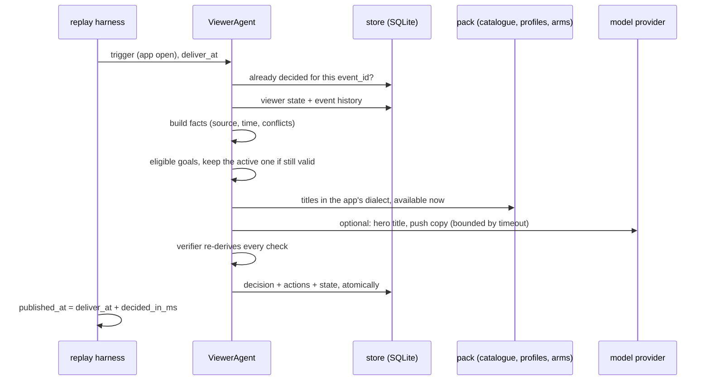
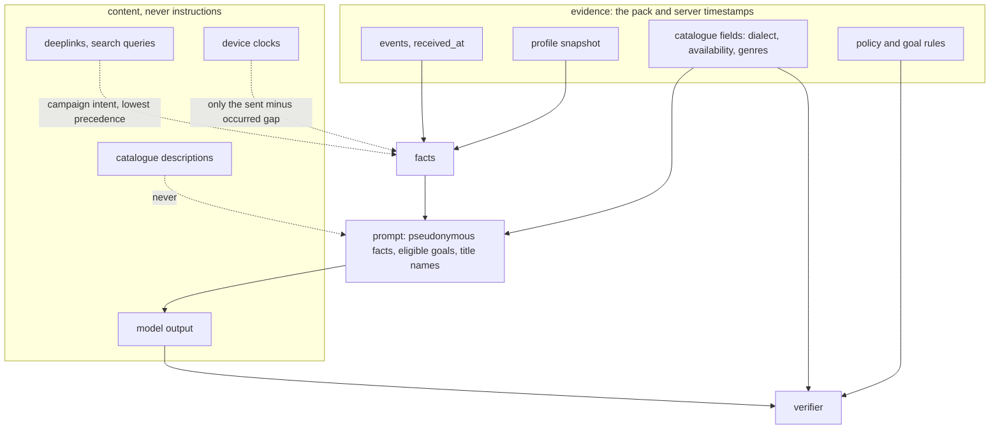

# Architecture

One agent per viewer, a deterministic core, and a model that may only advise. This note covers ownership,
planning, memory, verification, latency, failure recovery and trust boundaries, in that order, then measurement.

## One decision, end to end

## Ownership

`ViewerAgent` is created per `user_id` and owns that viewer's goal, single active plan and history. The agent
object is stateless; everything durable is a single state document in SQLite keyed by `user_id`, so two
components can never pursue different goals for one viewer. The document is versioned: a writer that read an older
version is refused (`StaleState`) and must re-read and decide again, so a second worker cannot silently overwrite
the owner's plan. Holdout viewers have an agent too: it chooses the
goal (a "shadow" goal, so the arms stay comparable) and publishes nothing.

## Planning

The goal is chosen by rules in `goals.py`, never by the model, so treatment and holdout get identical goal
assignment. The order depends on the viewer's lifecycle stage (`config.py`): new viewers aim for a first play or a
second-day return, trial viewers for a paid plan, subscribers for a weekly habit or a recent release, lapsed viewers
for coming back, free viewers for a first full episode or resuming a series. Within a stage, goals with a broad,
observable success signal come first so the holdout comparison has enough signal: in an earlier run, "resume this
exact series" succeeded about 4% of the time and "play any new release" about 29%. Two goals are never offered:
G10 has no success event and G11's event never occurs in the stream, which the rule book detects at start-up.

The active goal is kept while its window is open and the viewer still qualifies. It is revised on a state change,
not on a schedule: a live event that meets the success condition closes the goal at once (`handle_event`), a
purchase makes a monetisation goal moot, a lapse closes subscriber goals, and a closing goal cancels any message
it had scheduled. Judged outcomes feed back: a goal that failed for this viewer is not retried for seven days, and the
decision says so ("learned: ..."). `replay --continue-from <earlier state.db>` runs the next day on top of an earlier,
judged day, so this loop runs across days, not only in tests.

Interventions are proportionate. A home page is the default: it needs no consent, the app shows it only while the
viewer is there, and it is always rendered in the app's own dialect. One message at most, only for goals with a
concrete hook (resume a series, a new release, a trial ending): WhatsApp if the viewer opted in, else push, else an
in-app message, which needs no consent and is shown at the next open. A push or WhatsApp reaches the viewer outside
the app, so it needs evidence confidence of at least 0.6; when the app, profile and campaign disagree on dialect the
agent publishes the page only. "Do nothing" is a recorded decision with a reason: holdout, buffered-offline trigger,
duplicate, page still live, no catalogue in the app's dialect, no measurable goal, a veto, or not enough evidence:
below a confidence of 0.4 (no profile and no history, or no profile and disagreeing dialect sources) the agent
records the goal but publishes nothing.

The model is asked only when it can add something: push or in-app copy to write, or a hero title that the evidence
(a campaign link or the goal's own series) did not already decide. In the sample run that skips about a fifth of
the possible calls.

## Source handling and freshness

Every fact carries `source`, `observed_at` and evidence refs (`event:<id>`, `profile:<user>@<updated_at>`,
`trigger:<id>`). Precedence is fixed per fact:

| Fact | Wins | Why |
|---|---|---|
| dialect | app setting on the trigger, then profile, deeplink last | the app only shows a page for the dialect it is set to; the campaign link is intent, not reality |
| subscription status | purchase / renewal / lapse event received after the snapshot's `updated_at` | events are primary, the warehouse export is a day stale |
| consent | snapshot flag, overridden by a later `notification_opt_out` | policy rule 1 |
| signup, plays, completions, visits | events | the snapshot has no row for new viewers |
| duplicate profile rows | newest `updated_at` | same rule the platform simulator applies |

Conflicts are never resolved silently; they are listed on the decision (`conflicts`, `dialect.conflicts`).
Trigger freshness uses the device's own `sent_at - occurred_at` gap, which is reliable even when its clock is not:
an open buffered for more than ten minutes is not a live visit, so facts are recorded and nothing is published.

## Memory

`store.py` holds four tables: the event history (the viewer data store, de-duplicated by `event_id`), one state
document per viewer, every decision (indexed by trigger `event_id` for idempotency) and every action. Every
decision record carries the full fact table the agent used, and every evidence ref carries its own timestamp and
its age at decision time, so what the agent knew at any moment can be read back without replaying anything. The
state document holds the active goal, goal history with judged outcomes, and plain-language learnings; the planner
reads those learnings (see Planning). The judge replaces its own learnings on every run, so judging twice gives
the same state. `viewer_state/<user_id>.json` exports everything for one viewer; `inspect <user_id>` prints it.

## Verification

`verifier.py` runs after the planner and can veto it. It does not trust the planner's facts:

- it re-reads the viewer's events from the store and recomputes eligibility on that fresh read, so an event that
  arrived after planning can still stop the action;
- for goals that depend on the subscription (trial, first paid, lapsed, subscriber goals) it re-derives the status
  with its own code from the raw profile row and payment events;
- it derives consent with its own code from the profile row and later opt-out events;
- holdout arm, page dialect, availability at publish time (withdrawals included), page rules, the daily caps
  (push and WhatsApp share one, in-app has its own), templates and copy are checked against the pack and policy.
  "New episode" copy is allowed only for a recent release, and "your trial is ending" only when the trial,
  re-derived from the sources, ends within three days of the send time. Titles whose catalogue text tries to
  instruct an AI are held back from pages and messages until a person reviews them.

Each check has a scope: a failed message check drops the message and keeps the page; a failed page check drops the
page; holdout or eligibility failures drop everything. The eligibility rules themselves are shared code with the
planner, so the tests pin each rule; the subscription and consent checks are separate implementations on purpose.

Model output is generated text: a goal claim without an eligible rule behind it is rejected with the eligible set
cited, and copy that contains instruction-like phrases is discarded. The same pattern scans the catalogue at load,
so descriptions that try to instruct an AI are flagged in the run summary (they are never sent to the model).

## Latency and budget

Each decision runs under a `Budget`: at most 8 model calls and 20 tool calls (configurable), a 10 s model timeout,
and a clock. The replay runs faster than real time, so time spent waiting is charged as simulated time: the mock
model's 1.2 s per call, a slow or timed-out data-store read, and the queue.

App opens wait in one shared queue for four decision workers (configurable). The wait counts against the same
60 s budget, so `decided_in_ms` is queue wait plus processing plus waiting on dependencies, and
`published_at = deliver_at + decided_in_ms`. When less budget is left than one model call would take, the agent
decides with rules alone. Over 60 s is `LATE`; over 5 minutes is `FAILED` and nothing is published. Duplicate
triggers return the earlier decision in one store lookup.

A surge monitor compares opens in the last 10 minutes with the hour before. At 2.5 times the baseline (and at least
30 opens) it marks a surge and the agent skips optional model calls until traffic settles. In the sample run it
caught both the offline-buffer burst and the evening peak. At real scale the same design shards by `user_id`
across workers; the store is the only coordination point.

## Failure recovery

| Failure | Response |
|---|---|
| model returns 503, times out or returns unparsable JSON | rule-based decision, `fallback_used: model_unavailable`; the timeout costs our 10 s, not the model's |
| viewer data store times out (retried once) | smallest safe action: a popular-in-dialect page needing nothing about the viewer, goal left unchosen, state not overwritten; no action if the dialect is unknown |
| tool or model budget exhausted | recorded no-action with the reason |
| traffic surge or a long queue | optional model calls are skipped; rules decide; the queue wait is charged to the budget |
| a control event type nobody handles | logged and shown in the final report; nothing crashes |
| a title is withdrawn | catalogue updated; live pages containing it are republished without it; pending messages about it are cancelled |
| a goal rule is corrected | rule book versioned; only viewers with that goal open are tagged; every open goal is judged under the rule in force |
| a viewer opts out after a message was scheduled | the scheduled message is cancelled |

## Scale, and what stays human

- **1,000 opens in one minute.** Each open is an independent unit of work keyed by `user_id`; workers pull from one
  queue, the queue wait counts against the 60 s budget, and optional model calls are the first thing shed. The
  expensive part (reading one viewer's events) is a single indexed read.
- **10 million viewers, 40 dialects.** Shard the event store and the viewer documents by `user_id`; the catalogue
  index is per dialect and small. Goal rules and policy are data (`goals.json`, `interventions.json`), so new
  dialects need catalogue rows, not code. A rule correction touches only viewers with that goal open (an index on
  `active_goal`), never everyone.
- **Never automated.** Prices, offers and plan changes (only `pricing.json` prices, no invented discounts); adding or
  approving message templates; releasing a quarantined title; changing consent; and rolling the agent out wider. The
  agent proposes and records; people approve those.
- **Was doing nothing right?** Holdout viewers get the same goals, and the agent-arm viewers it chose not to act for
  keep their goals too, so their outcomes are measured against the holdout like everyone else's. Abstentions are
  recorded with reasons, so a later analysis can compare "abstained" against "acted" within each reason.

## Trust boundaries

The model sees a compact, pseudonymous fact summary, the eligible goals and candidate title names and genres.
It never sees descriptions, queries or deeplinks, and its answer is data to be checked, not approval. The pack is
treated as personal data: nothing is uploaded in mock mode, and the live adapter sends only the prompt above.

## Measurement

The judge reads the simulator's outcome events plus the replay day's live events and judges each committed goal
inside its window under the rule in force: succeeded, failed, or inconclusive when the window outlives the data.
Attribution records whether the viewer actually saw something the agent published before the success event.
Impact is intention-to-treat: every triggered viewer in both arms has a goal from the same rules; the agent arm's
success rate is compared with the holdout's with a 95% interval. The report also shows the exposed-vs-unexposed
comparison inside the agent arm and the pilot's served-vs-others headline, and explains why both overstate the
effect: exposure requires coming back, and viewers who come back succeed more anyway.
