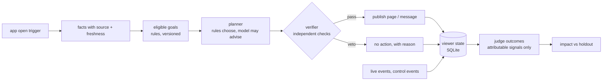

# One User, One Agent

**Made by: Satvik Pandey**

A lifecycle agent for a regional-dialect OTT app. Every viewer gets one agent. When the viewer opens the app the
agent has seconds to pick one measurable goal, decide what to change (home page, one message, or nothing),
verify that the change is safe, and publish it. Later it judges from real events whether the goal was reached
and measures its own effect against a randomized holdout.

The core is deterministic rules over evidence with provenance. A language model is optional and advisory: it
can pick the hero title and draft push copy, never decide eligibility or add an action. Mock mode is the default
and needs no API key.



## Demo app

```bash
streamlit run app.py          # opens http://localhost:8501
```

| Tab | What you can do |
|---|---|
| **Overview** | See the replay day at a glance: decisions, time budget, policy violations, why the agent did nothing, the surprises it handled. |
| **Explore a viewer** | Pick a situation from the brief (holdout, dialect conflict, false model claim, outage, duplicate…) and walk that viewer from app open to judged outcome. |
| **Try the agent** | Run the real agent live on one app open. Change the hour, the app dialect, or how long the open sat offline, and break things on purpose (model down, false claim, broken JSON, data store down, duplicate delivery). See the decision, every check and the machine-readable record. |
| **Impact vs holdout** | Agent arm vs randomized holdout, overall or per goal, with the honest verdict. |

The app reads `sample_run/` and the pack at `./pack` (override with `VIEWER_AGENT_RUN` / `VIEWER_AGENT_PACK`).
"Try the agent" works on an in-memory copy of the data, so it never changes the saved run. The app serves on
localhost only, because the pack is personal data.

## Quick start

Python 3.10 or newer. The data pack is not in this repository (it is treated as personal data); place it at
`./pack` or pass `--pack <path>`.

```bash
pip install -r requirements.txt
pip install -e .

# one command: replay the trigger stream, run the pack simulator, judge every goal, write the reports
python -m viewer_agent run-all --pack ./pack --out sample_run

# the same, step by step
python -m viewer_agent replay   --pack ./pack --out sample_run
python -m viewer_agent simulate --pack ./pack --out sample_run --seed oua-practice
python -m viewer_agent judge    --pack ./pack --out sample_run
python -m viewer_agent impact   --pack ./pack --out sample_run

# the demo app
streamlit run app.py

# everything the agent knew, decided and observed for one viewer
python -m viewer_agent inspect U-00649 --out sample_run

# tests (they use a small pack under tests/fixtures, not the real one)
pytest -q
```

The full replay (2,769 triggers) takes about a minute in mock mode.

## Live model (optional)

Mock mode replays the scripted model faults and outages from the pack. To use a real model, set an
OpenAI-compatible endpoint and pass `--provider openai`:

```bash
export OPENAI_API_KEY=...            # never committed; evaluators do not need one
export OPENAI_BASE_URL=...           # optional: OpenRouter, Groq, or any OpenAI-compatible server
export VIEWER_AGENT_MODEL=...        # default gpt-4o-mini
python -m viewer_agent replay --pack ./pack --out live_run --provider openai
```

Only a pseudonymous fact summary, the eligible goals and candidate title names reach the model. Catalogue
descriptions and other free text never do.

## What a run produces

| File | What it is |
|---|---|
| `sample_run/decisions.jsonl` | One record per trigger: goal, action or reason for none, evidence with freshness, conflicts, assumptions, checks, budget, timing, status |
| `sample_run/actions.jsonl` | Published actions in the simulator's input format |
| `sample_run/outcomes.jsonl` | Verdict (succeeded / failed / inconclusive) and attribution for every committed goal |
| `sample_run/viewer_state/<user_id>.json` | Durable per-viewer state: facts, goal history, decisions, actions, outcomes, learnings |
| `sample_run/latency_report.json` | Decision time percentiles, budget compliance, peak load |
| `sample_run/replay_summary.json` | Counts, control events handled, plan revisions from live events |
| `sample_run/impact_report.md` | Agent arm vs holdout arm, by goal, and why the simpler comparison misleads |
| `sample_run/final_report.md` | One-page summary of the sample run |
| `sample_run/sim/` | The pack simulator's outcome events and report |

## Layout

```
app.py          the Streamlit demo app
src/viewer_agent/
  pack.py       catalogue, profiles, arms, config (read-only)
  store.py      SQLite: event history + per-viewer state, decisions, actions
  facts.py      facts with source, time and conflicts
  goals.py      the 12 goals as versioned rules; eligibility and judging
  content.py    home-page rows and message drafts from the catalogue
  planner.py    rule-based proposal; model providers (mock, OpenAI-compatible)
  verifier.py   independent checks that can veto the planner
  agent.py      one agent per viewer; budget; degraded modes
  replay.py     the replay harness and its outputs
  judge.py      outcomes, attribution, impact report
  cli.py        commands
tests/          47 tests on a hand-made mini pack (duplicates, late triggers, conflicts, faults, corrections, policy, CLI, app)
sample_run/     output of run-all on the supplied pack (state.db is not committed; run-all rebuilds it)
```

Read next: `ARCHITECTURE.md` for the design, `KNOWN_LIMITATIONS.md` for what was left out and every assumption,
`AI_COLLABORATION.md` for how AI tools were used, `sample_run/final_report.md` for what happened in the replay.
