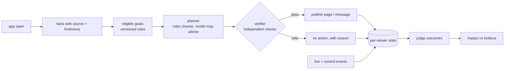

# One User, One Agent

**Made by: Satvik Pandey**

A lifecycle agent for a regional-dialect OTT app. Every viewer gets one agent. When the viewer opens the app, the
agent picks one measurable goal, decides what to change (home page, one message, or nothing), verifies the change
independently and publishes it within 60 seconds. Later it judges from real events whether the goal was reached and
measures its own effect against the randomized holdout.

The core is deterministic rules over evidence with provenance. A language model is optional and advisory only: it
can suggest a hero title or message wording, never choose the goal or decide eligibility. Mock mode is the default
and needs no API key.



## Setup

Python 3.10+. The data pack is not in this repository (the brief asks to treat it as personal data); place it at
`./pack` or pass `--pack <path>`.

```bash
pip install -r requirements.txt
pip install -e .
```

## Run

```bash
# one command: replay the trigger script, run the pack simulator, judge every goal, write the reports
python -m viewer_agent run-all --pack ./pack --out sample_run

# everything the agent knew, decided and observed for one viewer
python -m viewer_agent inspect U-00649 --out sample_run

# tests (a small hand-made pack under tests/fixtures, not the real one)
pytest -q
```

The full replay (2,769 triggers) takes about a minute. The steps also run one by one: `replay`, `simulate`,
`judge`, `impact`. `replay --continue-from sample_run/state.db` runs a second day on top of a judged first day.

**Demo app (optional):** `streamlit run app.py` opens a one-page app on localhost. Pick a viewer and, if you like, a
failure (model down, data store down, duplicate or late open); the real agent runs and shows Decide, Act and
Measure, plus agent vs holdout.

**Live model (optional):** set `OPENAI_API_KEY` (and `OPENAI_BASE_URL` for any OpenAI-compatible server) and add
`--provider openai`. Only a pseudonymous fact summary and candidate title names reach the model, never catalogue
descriptions.

## Sample run output

| File | What it is |
|---|---|
| `decisions.jsonl` | One record per trigger: goal or reason for none, evidence with freshness, conflicts, assumptions, confidence, checks, timing, status |
| `actions.jsonl` | Published actions, in the simulator's input format |
| `outcomes.jsonl` | Verdict (succeeded / failed / inconclusive) and attribution for every goal |
| `viewer_state/<id>.json` | Durable per-viewer state: facts, goals, decisions, actions, outcomes, learnings |
| `latency_report.json` | Decision time percentiles and budget compliance |
| `impact_report.md` | Agent arm vs holdout, by goal, and why the pilot's headline misleads |
| `final_report.md` | One-page summary of the run |

## Layout

```
app.py                optional demo app
src/viewer_agent/
  pack.py             catalogue, profiles, arms, config (read-only)
  store.py            SQLite: events, per-viewer state, decisions, actions
  facts.py            facts with source, time and conflicts
  goals.py            the 12 goals as versioned rules; eligibility and judging
  content.py          home-page rows and message drafts
  planner.py          rule-based proposal; model providers (mock, OpenAI-compatible)
  verifier.py         independent checks that can veto the planner
  agent.py            one agent per viewer; budget; degraded modes
  replay.py           replay harness, worker queue, surge detection
  judge.py            outcomes, attribution, impact report
  cli.py              commands
tests/                90 tests: late and duplicate triggers, conflicts, failures, corrected rule, verifier, judge, CLI, app
sample_run/           output of run-all on the supplied pack
```

Read next: [ARCHITECTURE.md](ARCHITECTURE.md) for the design, [KNOWN_LIMITATIONS.md](KNOWN_LIMITATIONS.md) for
what was left out and every assumption, [AI_COLLABORATION.md](AI_COLLABORATION.md) for how AI tools were used.
